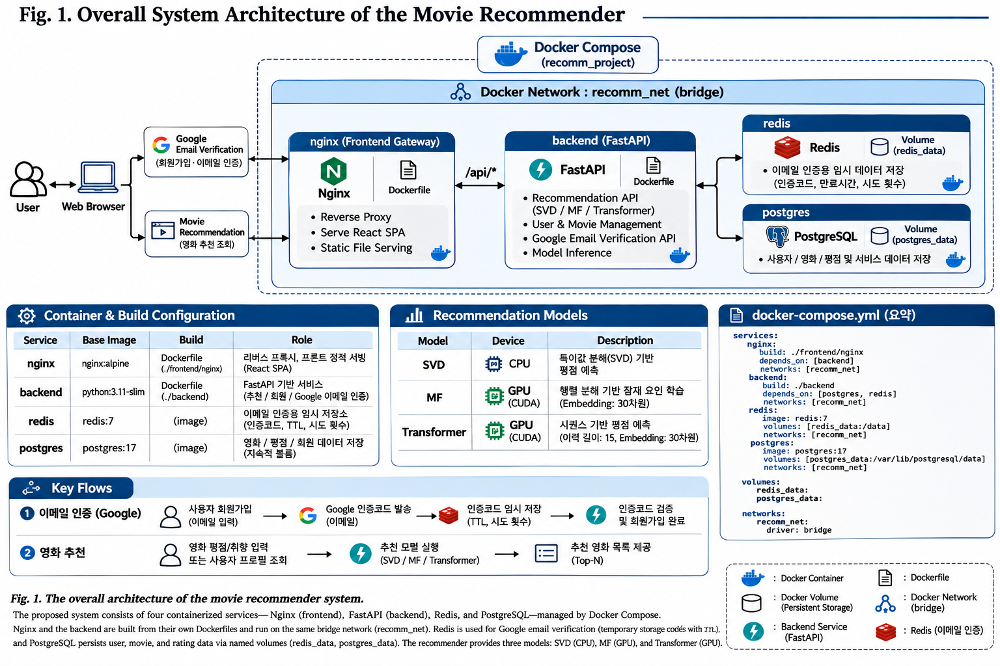

# 🎬 Movie Recommender System

**SVD · Matrix Factorization(MF) · Transformer 기반 영화 추천 웹 서비스**

사용자의 영화 평점 데이터를 활용해 세 가지 추천 알고리즘을 구현하고, 모델별 추천 결과와 예측 성능을 비교하는 프로젝트입니다. React 웹 화면에서 추천을 요청하면 FastAPI가 학습된 모델을 불러와 사용자가 아직 평가하지 않은 영화를 추천합니다.

## 🏗️ 전체 시스템 구조



> 구조도 이미지 파일은 저장소의 `docs/architecture.png`에 배치합니다. 구조도는 개념도입니다.

```text
사용자 → Nginx → React (Vite)
               └─ /api/* → FastAPI
                            ├─ SVD 추천
                            ├─ MF 추천 (PyTorch)
                            ├─ Transformer 추천 (PyTorch)
                            ├─ PostgreSQL (영화·평점·회원 데이터)
                            ├─ Redis
                            └─ checkpoint/ (학습 모델 및 KPI)
```

## 🧠 추천 알고리즘 비교

| 모델 | 학습 환경 | 핵심 아이디어 | 추천 방식 |
|---|---|---|---|
| **SVD** (Singular Value Decomposition) | **CPU** | 사용자–영화 평점 행렬을 저차원 잠재 요인으로 분해 | 잠재 요인으로 평점 행렬을 근사해 미평가 영화의 평점 예측 |
| **MF** (Matrix Factorization) | **GPU (CUDA)** | 사용자와 영화 각각을 학습 가능한 임베딩 벡터로 표현 | 두 임베딩을 활용해 예상 평점을 학습하고 높은 순으로 추천 |
| **Transformer** | **GPU (CUDA)** | 사용자가 평가한 영화와 평점의 이력을 Attention 기반 모델로 처리 | 이력과 추천 후보 영화를 함께 입력해 예상 평점을 계산 |

### 1. SVD — 행렬 분해 기반 추천

사용자–영화 평점 행렬을 특이값 분해하여 중요한 잠재 요인을 추출합니다. 축소한 행렬을 재구성해 관측되지 않은 평점을 추정합니다. 행렬 분해가 추천에 활용되는 원리를 이해하기 위한 기준 모델입니다. **CPU에서 실행·학습했습니다.**

### 2. MF — 임베딩 학습 기반 추천

사용자와 영화에 각각 **30차원 임베딩**을 부여하고, 실제 평점과 예측 평점의 오차를 줄이도록 PyTorch로 학습합니다. 사용자가 아직 평가하지 않은 영화의 점수를 예측해 상위 영화를 추천합니다. **GPU(CUDA)에서 학습했습니다.**

### 3. Transformer — 평가 이력 기반 추천

사용자의 최근 영화 평가 이력(최대 **15개**)과 각 평점을 입력으로 받아, 후보 영화에 대한 예상 평점을 계산합니다. MF와 달리 여러 영화의 이력을 함께 고려합니다. **GPU(CUDA)에서 학습했습니다.** 현재 데이터에는 실제 관람 시각 정보가 없으므로, 이력 순서를 **실제 시간순 관람 순서로 해석하면 안 됩니다.**

> **실행 환경:** SVD는 CPU, MF와 Transformer는 NVIDIA GPU에서 학습했습니다. Docker 배포 환경은 별도로 GPU를 설정하지 않으면 CPU로 추론할 수 있습니다.

## 📊 모델 평가

모델별로 검증 데이터의 실제 평점과 예측 평점을 비교합니다.

| 지표 | 의미 | 해석 |
|---|---|---|
| **MAE** | 평균 절대 오차 | 낮을수록 좋음 |
| **MSE** | 평균 제곱 오차 | 낮을수록 좋음 |
| **RMSE** | 평균 제곱근 오차 | 낮을수록 좋음 |

MF와 Transformer는 기존 학습 체크포인트에 KPI가 없을 경우 최초 조회 시 검증 평가를 수행한 뒤 **같은 `.pt` 파일에 KPI를 저장**합니다. 이후 조회에서는 저장된 KPI를 재사용하므로 모델을 다시 학습하지 않습니다.

## 🛠️ 기술 스택

| 구분 | 기술 |
|---|---|
| Frontend | React, Vite, Ant Design |
| Backend | Python, FastAPI |
| ML | NumPy, PyTorch, SVD / MF / Transformer |
| Database | PostgreSQL 17 |
| Cache / Infrastructure | Redis 7, Nginx |
| Deployment | Docker, Docker Compose |

## 📁 프로젝트 구조

```text
recomm_project/
├── docs/
│   └── architecture.png
├── backend/
│   ├── app/
│   │   ├── svd/
│   │   ├── mf/
│   │   └── transformer/
│   ├── checkpoint/
│   │   ├── svd_model.joblib
│   │   ├── mf.pt
│   │   └── transformer.pt
│   ├── Dockerfile
│   └── requirements.txt
├── frontend/
│   ├── src/
│   ├── nginx/
│   │   ├── Dockerfile
│   │   └── nginx.conf
│   └── package.json
├── docker-compose.yml
├── .env                 # Git에 업로드하지 않음
└── README.md
```

## 🔌 주요 API

| API | 설명 |
|---|---|
| `GET /svd/kpi` | SVD 모델 성능 조회 |
| `GET /mf/kpi` | MF 모델 성능 조회 |
| `GET /transformer/kpi` | Transformer 모델 성능 조회 |
| `GET /mf/recommendations?user_id=1` | MF 추천 영화 조회 |
| `GET /transformer/recommendations?user_id=1` | Transformer 추천 영화 조회 |

Nginx를 통한 웹 접근 시 API 경로 앞에 `/api`가 붙습니다. 예: `/api/mf/kpi`.
## 🐳 Docker 실행 및 확인

### 1. 실행 환경

- Docker Desktop
- Docker Compose
- NVIDIA GPU (GTX 1660, CUDA 학습 환경)
- `.env` 환경변수 설정

> SVD는 CPU, MF와 Transformer는 GPU(CUDA)를 이용해 학습했습니다. Docker에서 추천 API를 실행할 때는 별도의 GPU 설정이 없다면 CPU로 추론할 수 있습니다.

### 2. 프로젝트 실행

프로젝트 루트에서 실행합니다.

```powershell
cd D:\bej\recomm_project

# 기존 PostgreSQL 볼륨 확인
docker volume inspect recomm_project_postgres_data

# Docker Compose 설정 확인
docker compose config --quiet

# 전체 서비스 빌드 및 실행
docker compose up -d --build

# 실행 상태 확인
docker compose ps
```

### 3. 서비스 접속

`.env` 파일의 `NGINX_PORT` 값을 기준으로 접속합니다.

예시: `NGINX_PORT=8080`

- 웹 서비스: http://localhost:8080
- API 문서: http://localhost:8080/api/docs

### 4. 코드 수정 후 재배포

프론트엔드와 백엔드 코드를 수정한 경우:

```powershell
docker compose up -d --build --no-deps backend nginx
```

백엔드 로그 확인:

```powershell
docker compose logs -f backend
```

### 5. 데이터 및 모델 보존

PostgreSQL은 기존 외부 Docker 볼륨 `recomm_project_postgres_data`를 사용합니다.

- PostgreSQL 데이터는 Docker 볼륨에 유지됩니다.
- 학습된 모델은 `backend/checkpoint/`에 보관합니다.
- 모델 체크포인트는 GitHub 저장소에도 포함합니다.
- `docker compose down -v`, `docker volume prune` 등 데이터 볼륨 삭제 명령은 사용하지 않습니다.

> **주의:** Docker Compose 설정에서 `postgres_data`가 기존 외부 볼륨을 참조하는지 확인한 후 실행하세요. 기존 데이터가 저장된 볼륨을 삭제하거나 다른 빈 볼륨으로 교체하지 않습니다.
> **데이터 보존:** `docker compose down -v`, `docker volume prune` 등 볼륨을 삭제하는 명령은 사용하지 않습니다. PostgreSQL 볼륨은 Git에 포함되지 않습니다. 모델 체크포인트는 Git에 포함하되 별도 백업도 권장합니다.

## 🎯 프로젝트 목적

단순한 영화 추천 기능 구현을 넘어, **전통적인 행렬 분해(SVD) → 학습형 잠재 요인 모델(MF) → 이력 기반 딥러닝(Transformer)** 으로 발전하는 추천 시스템의 구조와 차이를 이해하고, 이를 FastAPI·React·Docker 기반의 실제 웹 서비스로 연결하는 것을 목표로 합니다.
